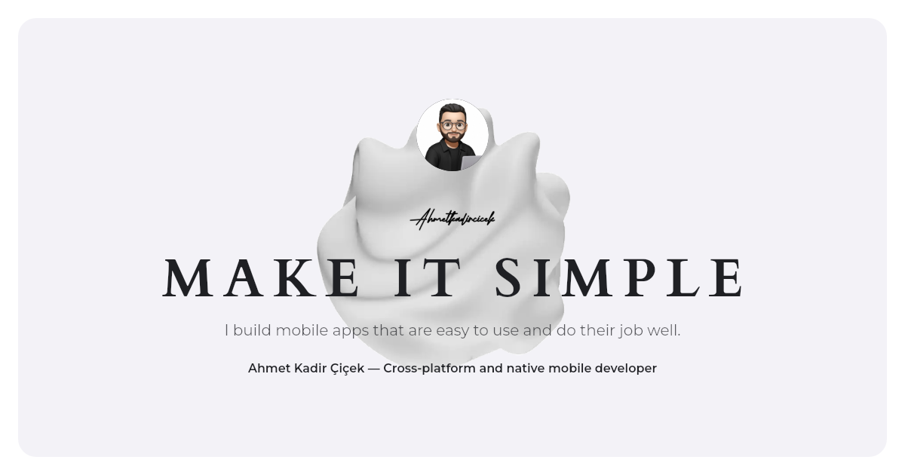

# Portfolio

**Live: [ahmetkadircicek.com.tr](https://ahmetkadircicek.com.tr)**



Portfolio of Ahmet Kadir Çiçek, mobile developer. A Flutter web app compiled to WebAssembly, in English, Turkish and German, hosted on Firebase (project `portfolio-9e0f3`) with a Firestore-backed contact form.

## Run locally

```sh
flutter pub get
flutter run -d chrome
```

## Build and deploy

GitHub Actions deploys the site; nothing needs to run locally.

| Event | Workflow | Result |
| --- | --- | --- |
| Pull request | `.github/workflows/firebase-hosting-pull-request.yml` | analyze, test, build, then a Firebase preview channel; the preview URL is posted on the pull request and expires after 7 days |
| Push to `main` | `.github/workflows/firebase-hosting-merge.yml` | analyze, test, build, then the live site |

Both use the `FIREBASE_SERVICE_ACCOUNT_PORTFOLIO_9E0F3` repository secret, created by `firebase init hosting:github`. The Flutter version is pinned in both workflows; change it there together with your local SDK.

`tool/build_web.sh` is the one build command: `flutter build web --release --wasm --no-web-resources-cdn --pwa-strategy=none`, then `tool/service-worker-cleanup.js` installed as `/flutter_service_worker.js`, then the generated files below. To deploy by hand:

```sh
tool/build_web.sh && firebase deploy --only hosting
```

Firestore rules are not deployed by the workflows; after changing `firestore.rules`, run `firebase deploy --only firestore:rules`.

The site has no service worker. Versions before October 2026 installed Flutter's caching worker, which keeps serving the old app from its cache; `web/index.html` removes it on the next visit and the cleanup worker covers browsers that check for worker updates in the background.

`--wasm` produces both a WebAssembly and a JavaScript build. Browsers with WasmGC (recent Chrome, Edge, Firefox) load the smaller and faster Wasm renderer; others fall back to JavaScript automatically.

Flutter draws to a canvas that search engines, link previews and language models cannot read, so the build adds plain files for them, all from the site's data:

| Step | Writes |
| --- | --- |
| `tool/og_image_test.dart` | a 1200×630 link preview image per entry and a home card, per language, in `og/` |
| `tool/generate_site_test.dart` | an HTML file per page and language (`tr/projects/tunes.html`) with its title, description, canonical, hreflang, link preview tags and JSON-LD, and the page as hidden text; `sitemap.xml` with every language; `llms.txt` |

They run as tests because the data uses `dart:ui`. The parts of `web/index.html` they replace sit between `page:head` and `page:body` markers. `docs/preview.png` is a copy of `og/en/home.png`.

Pages are in English at `/`, Turkish under `/tr` and German under `/de`; the address decides the language.

The first deploy needs a Firestore database: Firebase console → Firestore Database → Create database.

## Contact form

Messages are written to the Firestore `messages` collection and can be read in the Firebase console. `firestore.rules` only allows creating a message with the expected fields and sizes; nothing can be read, changed or deleted from the site.

To try the form without touching production:

```sh
flutter build web --release --wasm --dart-define=USE_FIRESTORE_EMULATOR=true
firebase emulators:start --only firestore --project portfolio-9e0f3
# serve build/web on any static server, open /contact and send a message
```

## Content

Projects and jobs are both `Entry` items in a `Collection` (`lib/core/data/entry.dart`). Adding an `Entry` to a collection's list adds its row on the home page and its page at `/<collection>/<slug>`; nothing else needs to change. An entry with `highlights` gets the image deck on its page; one without is text only.

| What | Where |
| --- | --- |
| Projects (texts, logos, statuses, highlight images, links) | `lib/core/data/projects.dart` |
| Work experience | `lib/core/data/experience.dart` |
| Which collections the site has, in home page order | `lib/core/data/collections.dart` |
| Design tokens (colors, spacing, radius, motion, breakpoints) | `lib/core/theme/app_tokens.dart` |
| Type scale (Cardo headings, Montserrat text) | `lib/core/theme/app_text.dart` |
| Home sections (hero, collection lists, what I do, footer) | `lib/features/home/widget/` |
| Entry page shared by every project and job | `lib/features/entry/view/entry_view.dart` |
| CV | `web/ahmet-kadir-cicek-cv.pdf` (served as `/ahmet-kadir-cicek-cv.pdf`) |
| Link preview images, page texts for search engines, sitemap | generated at build time from the data (see Build and deploy) |

Images are WebP and sized for their largest on-screen use: screenshots 720 px wide, mockups 1400 px (the project page zooms them 2.5x on hover), logos 256 px.

Widgets use only the tokens; a raw color, size or duration in a widget is a bug.
